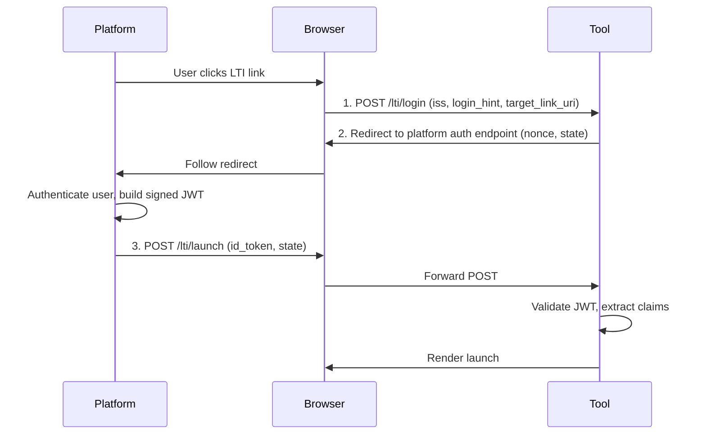

# LTI Advantage Concepts

LTI 1.3 defines how learning platforms connect with external tools. Understanding these concepts will help you configure Ltix, implement your storage adapter, and debug launch issues. If you're already familiar with LTI 1.3, skip ahead to [How Ltix fits in](#how-ltix-fits-in).

## What is LTI?

Learning Tools Interoperability (LTI) connects learning platforms (like Canvas, Moodle, or Blackboard) with external tools (like a quiz engine, coding sandbox, or video player). When a student clicks a link in their course, the platform launches the tool with information about who the user is, what course they're in, and what role they have.

LTI 1.3 uses OpenID Connect (OIDC) for the launch flow and signed JWTs for the data payload.

## Launch flow

An LTI launch is a three-step browser redirect.



1. **Login initiation** - the platform sends the tool a login request for a user who wants to launch. The tool doesn't have the user's identity yet. It receives only the platform's identity and a hint. Ltix handles this in `handle_login/3`.

2. **Authentication request** - the tool sends the browser to the platform's authentication endpoint with a nonce and state parameter. The platform authenticates the user and builds a signed JWT.

3. **Launch** - the platform POSTs the signed JWT back to the tool. The tool validates the signature, checks the nonce, and extracts the launch data. Ltix handles this in `handle_callback/3`.

The state parameter (stored in the session between steps 1 and 3) provides CSRF protection. It proves the launch callback came from the same browser session that initiated the login.

## Registrations

A **registration** is the security contract between your tool and a platform, set up out of band when a platform administrator adds your tool, usually through a configuration screen on both sides.

A registration contains the following fields.

| Field | What it is |
|---|---|
| `issuer` | The platform's identity URL (e.g. `https://canvas.instructure.com`) |
| `client_id` | Your tool's OAuth2 client ID on that platform |
| `auth_endpoint` | Where to redirect users for authentication |
| `jwks_uri` | Where to fetch the platform's public keys |
| `token_endpoint` | Where to request access tokens for service calls (optional) |
| `audience` | The audience the platform expects in token requests, when it differs from the token endpoint (optional) |

In Ltix, this is `Ltix.Registration`. Your `Ltix.StorageAdapter` looks up registrations by issuer and client_id, both during login initiation and again during launch validation.

## Deployments

A **deployment** is the set of contexts on a platform where your tool is available, such as one course or a whole institution. One registration, identified by issuer and client_id, can have many deployments, for example a tool installed in three different departments of the same university.

A deployment has a single `deployment_id` assigned by the platform. It's immutable, case-sensitive, and guaranteed unique within the registration.

In Ltix, this is `Ltix.Deployment`. Your storage adapter looks up deployments during launch validation, after the JWT is verified and its claims pass.

## Claims

A **claim** is one property of the ID token, such as the user's name or the context. Ltix parses claims into `launch.claims`, keyed by short names.

| Claims | Short names |
|---|---|
| User identity | `:subject`, `:name`, `:email` |
| Roles | `:roles` |
| Context | `:context` |
| Resource link, the link the user followed | `:resource_link` |
| Launch details | `:message_type`, `:version`, `:target_link_uri` |
| Service endpoints | `:ags_endpoint`, `:memberships_endpoint` |
| Values the platform sets for the link | `:custom` |

The **subject** is the platform's ID for the user. It never changes and is never reused. It's unique only within one platform. Key your users by subject and registration together.

Every launch has `:message_type`, `:version`, `:deployment_id`, and `:target_link_uri`. Every resource link launch also has `:roles` and `:resource_link`, and `:subject` unless you allow anonymous launches. Other claims are `nil` when the platform leaves them out, and `:roles` is `[]`.

```elixir
launch.claims.subject          #=> "user-12345"
launch.claims.context.title    #=> "Intro to Elixir", when the platform sent a context
```

Claims Ltix doesn't parse, such as a vendor's own, are in `launch.raw` under their full names. `Ltix.Core` lists Core's claims and their short names, and `Ltix.Launch` links the modules of the other claims Ltix parses.

## Roles

Platforms send roles as URI strings. A user can have multiple roles simultaneously, for example an instructor in the course and a staff member at the institution.

Roles come from three [vocabularies](https://standards.1edtech.org/lti/specifications/core/lti-spec#role-vocabularies).

- **Context** - course-level (instructor, learner, TA, content developer)
- **Institution** - org-level (faculty, student, staff, administrator)
- **System** - platform-level (system administrator, account administrator)

`launch.claims.roles` has the user's roles, and `Ltix.Role` checks them. See [Working with Roles](working-with-roles.md).

## Nonces

A **nonce** is a one-time-use random string that prevents replay attacks. The flow is as follows.

1. During login, Ltix generates a nonce tied to the login's state and registration
2. The nonce is included in the authorization request to the platform
3. The platform returns it in the signed JWT
4. During launch validation, Ltix checks the nonce against the state and calls your adapter to record it as used

If someone intercepts a JWT and tries to replay it, the nonce check fails because it was already used.

## How Ltix fits in

Ltix handles the protocol (OIDC redirects, JWT parsing, signature verification, claim validation). Your application handles the rest.

| Ltix's job | Your app's job |
|---|---|
| Build the authorization redirect | Store the OIDC state in the session |
| Validate the JWT signature and claims | Look up registrations and deployments |
| Parse roles, context, resource links | Record used nonces |
| Return structured launch data | Decide what to do with the launch |
